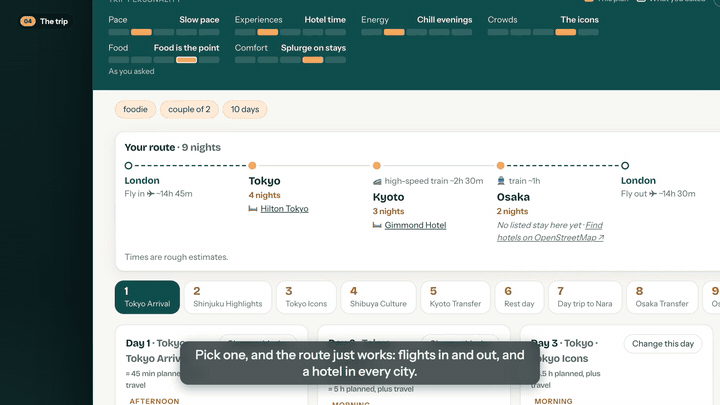
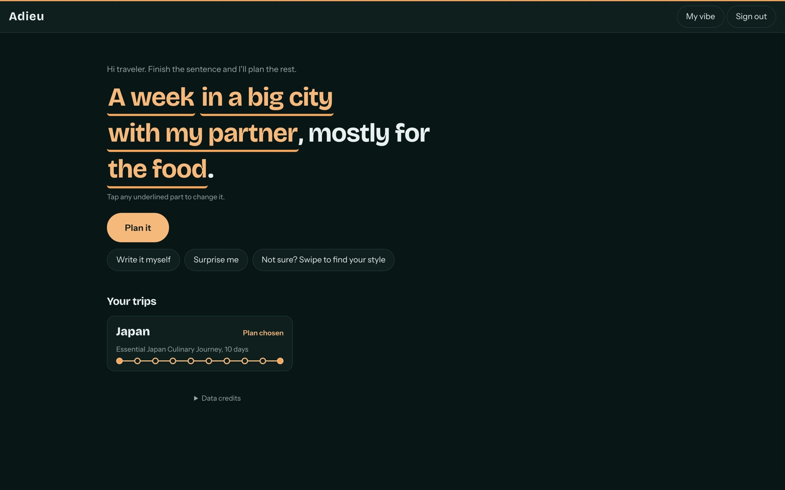
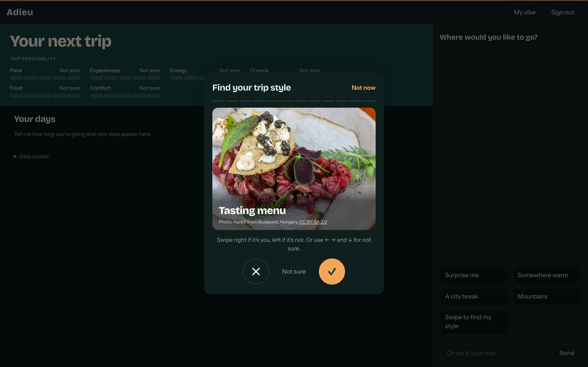
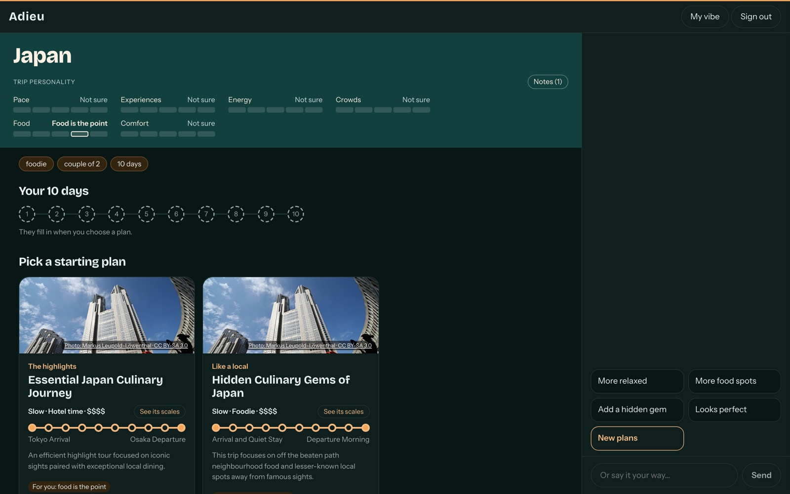
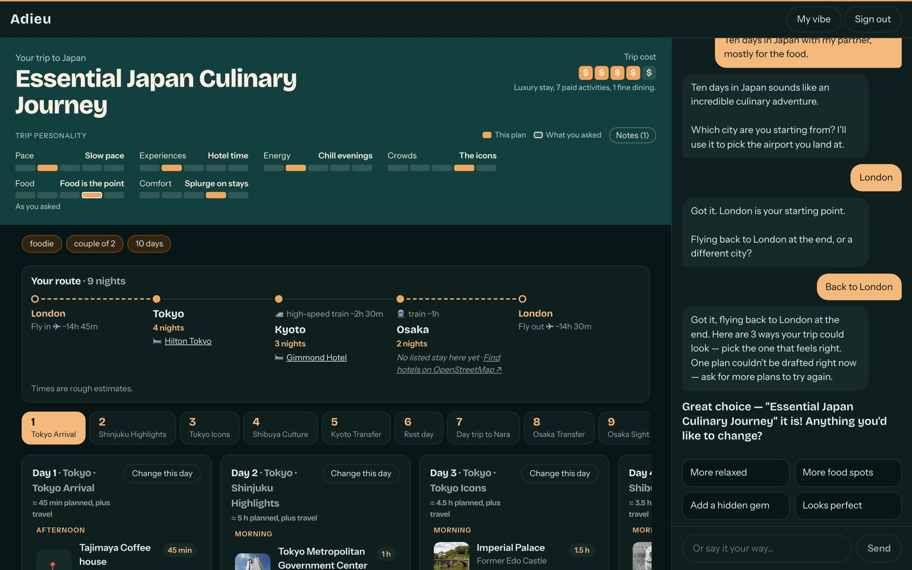
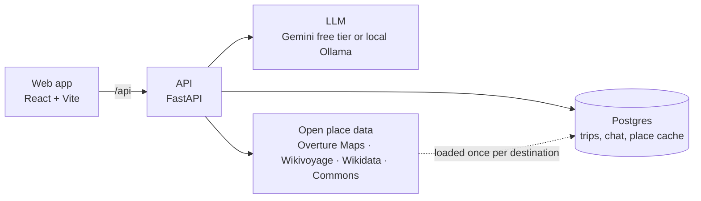

# 

**A travel planner that plans like a friend who knows you: one sentence in, a whole trip out.**

[](docs/readme/adieu-demo.mp4)

*56-second demo, made from the running app with a demo account. Click for the video with sound
([subtitles](docs/readme/adieu-demo.srt), [music, voice, font and photo credits](docs/readme/adieu-demo-CREDITS.txt)).*

## What it does

Tell Adieu your trip in one sentence ("Ten days in Japan with my partner, mostly for the food"). It asks only what it
still needs, writes a few plans, has an AI critic check each one, and turns the one you pick into a day-by-day trip.

| | |
|---|---|
|  |  |
| **Start with one sentence.** Tap any underlined part to change it. | **Not sure? Swipe.** Photo cards give the trip a personality. |
|  |  |
| **Pick a starting plan.** Each one has been reviewed, with anything to check first. | **The plan just works.** Flights in and out, a hotel per city, times for every stop. |

## The four ideas behind it

1. **"It gets me."** Every trip has its own personality on six scales (pace, experiences, energy, crowds, food,
   comfort) plus a $ to $$$$$ cost badge. Adieu asks the one question that tells it the most, offers a swipe deck
   when you can't say what you like, and shows each plan's marker next to what you asked for.
2. **"Worth the hype?"** *(planned)* A personal verdict on famous and viral places: worth it, worth it if…, or skip,
   with sources and an alternative.
3. **"You'd never have found this."** *(planned)* Local favourites, festivals and events during your dates, each with
   a source and a date, offered rather than added.
4. **"The plan just works."** Multi-city routes with the nights shared out, the cities in a sensible order, flights in
   and out and the train in between, a hotel in every city, a time for every stop, rest days, and edits by chat
   ("swap Osaka for Hiroshima") that change only what you asked.

The full plan is in [docs/PRODUCT.md](docs/PRODUCT.md); the code tour is in [docs/WALKTHROUGH.md](docs/WALKTHROUGH.md).

## How it fits together



The model chats, drafts, reviews and ranks; plain code checks every plan before you see it (real places from the
data, stops in the right city, a stay in every city, days that fit with travel time). Places, descriptions and photos come from open data, so no
paid places API is needed.

## Run it locally

You need Docker, and either a free [Gemini API key](https://aistudio.google.com/apikey) (fast) or
[Ollama](https://ollama.com) with `qwen3:8b` (private, slower).

```bash
cd travel-ai
cp .env.example .env
```

Edit `travel-ai/.env`:

- keep `APP_ENV=development` (the default, `production`, refuses to start with dev settings);
- set `SESSION_SECRET` to a long random string (`openssl rand -hex 32`);
- for Gemini, uncomment the four `LLM_` lines and add your key (left commented, the app uses Ollama on your machine);
- set `ALLOW_DEV_LOGIN=true` to sign in with just an email. **This is for your own machine only:** keep it `false`
  anywhere other people can reach the app, and use Google sign-in (`GOOGLE_OAUTH_CLIENT_ID`) there.

```bash
docker compose up -d --build
```

Open http://localhost:8080 (API docs at http://localhost:8000/docs). The first plan for a new destination takes
15–30 s while its places are loaded; after that they come from Postgres. More settings are in
[travel-ai-web/README.md](travel-ai-web/README.md).

## Licence

[MIT](LICENSE). Place data and photos keep their own licences, credited in the app under "Data credits"
(Wikivoyage CC BY-SA, Overture Maps, OpenStreetMap ODbL, Wikidata CC0, Wikimedia Commons per photo).
